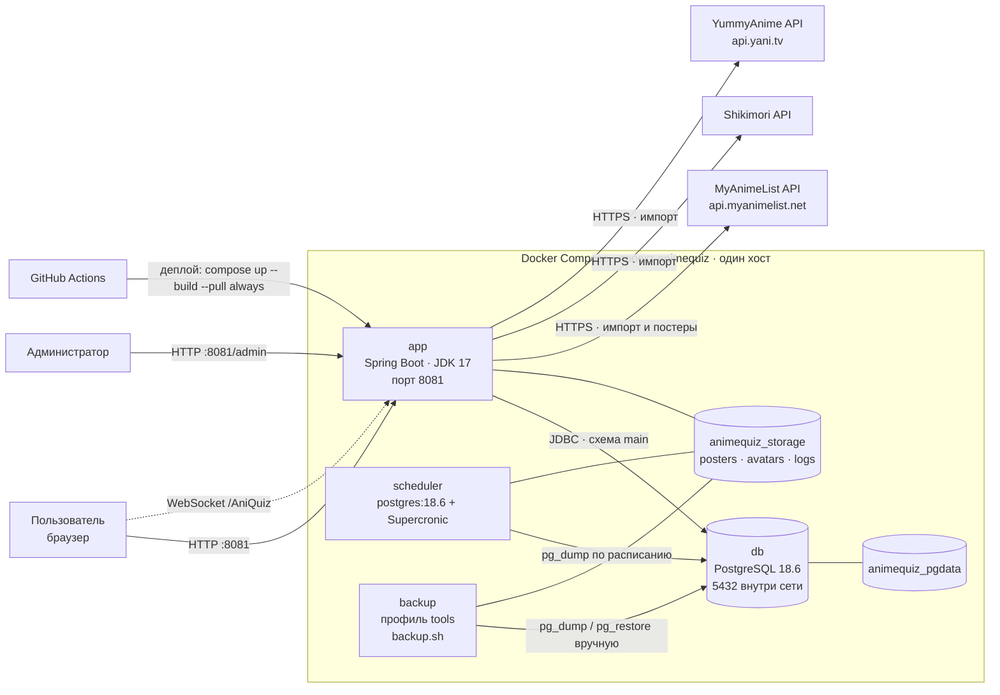
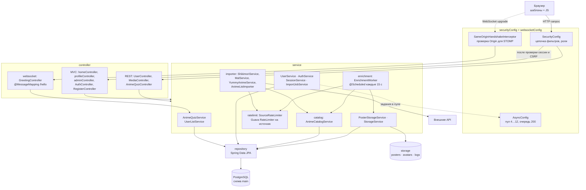
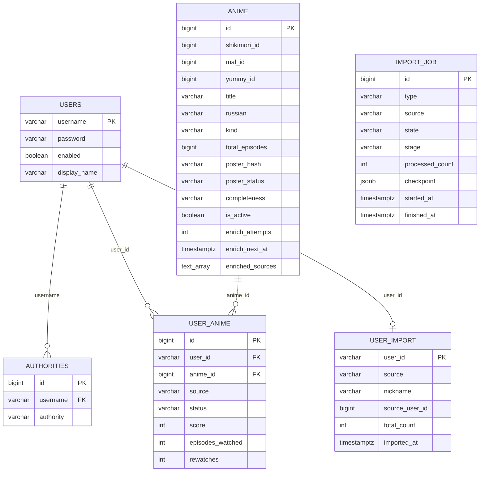
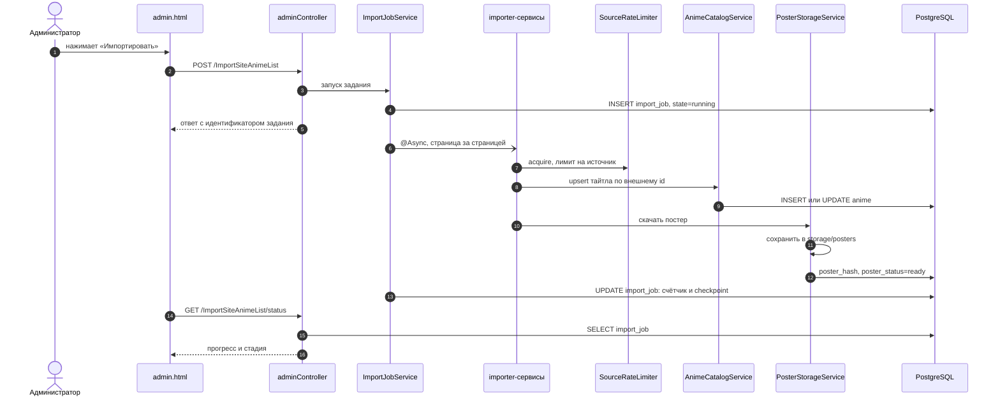
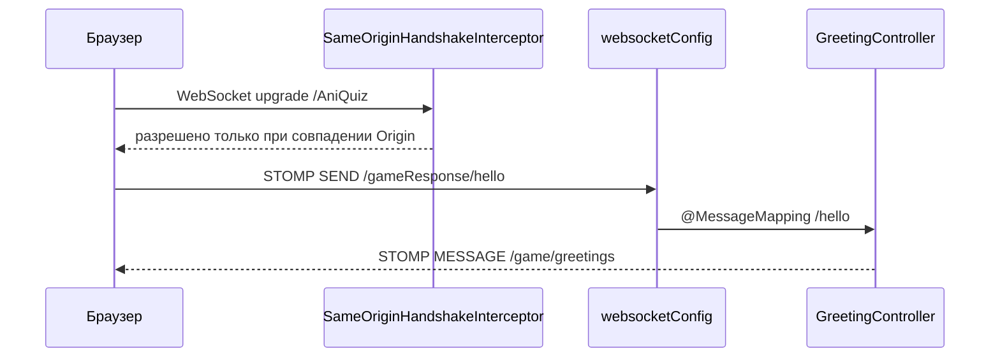
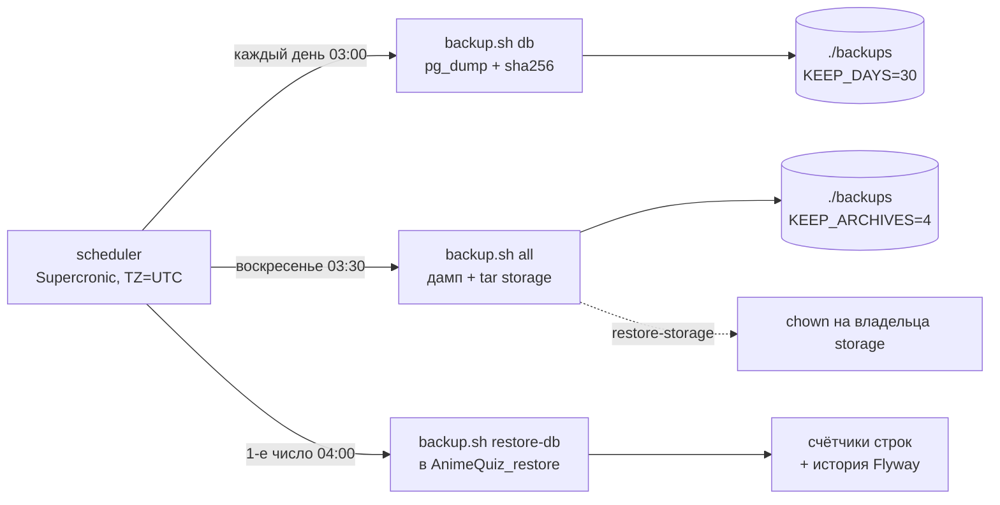
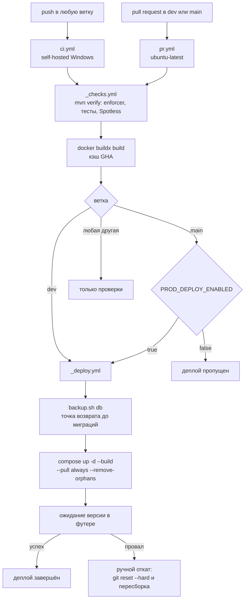

# Архитектура AnimeQuiz

Схемы ниже описывают то, что есть в репозитории на момент `0.1.30-SNAPSHOT`:
стек, слои кода, модель данных, потоки импорта и эксплуатацию. Файл локальный и
в git не попадает.

## 1. Стек

| Слой | Что используется |
|---|---|
| Язык и рантайм | Java 17 (Temurin), JVM-флаги `-XX:MaxRAMPercentage=75` |
| Фреймворк | Spring Boot 3.2.0 |
| Веб | Spring MVC, Thymeleaf, `thymeleaf-extras-springsecurity6` |
| Безопасность | Spring Security 6: form login, CSRF с `XorCsrfTokenRequestAttributeHandler`, роли `ADMIN` и `USER`, сессия 30 минут |
| Данные | Spring Data JPA + Hibernate, HikariCP (`maximum-pool-size` в `application.properties`) |
| База | PostgreSQL 18.6, схема `main` |
| Миграции | Flyway, 4 версии (`V1`…`V4`) |
| Реалтайм | Spring WebSocket + STOMP, простой брокер, эндпоинт `/AniQuiz`, очереди `/game/**` и `/gameResponse/**` |
| Утилиты | Lombok, Guava (`RateLimiter`, `Cache`, `Striped`) |
| Фронтенд | Ванильный JS + собственные CSS, `@stomp/stompjs` в лобби, без сборщика |
| Контейнеры | Docker Compose v2: `db`, `app`, `backup` (профиль `tools`), `scheduler` |
| Наблюдаемость | Логи в stdout и в `storage/logs/app.log`, ротация json-file 10 МБ × 3; actuator не подключён |

## 2. Контекст: кто с кем говорит

Пояснения:

- `app` публикует `8081:8081` на всех интерфейсах, `db` — только
  `127.0.0.1:5434`. Внутри сети Compose приложение ходит на `db:5432`, порт
  нужен только `psql` и pgAdmin на этой машине.
- `backup` не запускается вместе со стеком: это разовый инструмент,
  `docker compose --profile tools run --rm backup <команда>`.
- `scheduler` собран из `postgres:18.6`, потому что внутри нужны `pg_dump` и
  `psql` той же версии, что и сервер.
- Папка `./backups` монтируется в оба служебных контейнера, поэтому дампы
  лежат на хосте, а не в томе.
- `animequiz_pgtmp` — технический том: базовый образ Postgres объявляет
  `/var/lib/postgresql` как VOLUME, и без него Docker создавал бы анонимный том
  при каждом пересоздании `scheduler`.

## 3. Код: слои и пакеты

Правила, которые видны из схемы:

- Контроллеры не ходят в базу напрямую, только через сервисы и репозитории.
- Внешние API вызываются только из `service.importer` и
  `service.enrichment`, и всегда через `SourceRateLimiter`.
- Файлы пишет только `PosterStorageService` и `StorageService`; путь к
  каталогу задаётся `app.storage.location`.
- `ImportJobService` работает в пуле `AsyncConfig`, поэтому импорт не держит
  HTTP-запрос.

## 4. Данные

Что важно помнить:

- `anime` — единая запись на тайтл, три внешних идентификатора
  (`shikimori_id`, `mal_id`, `yummy_id`) уникальны, поэтому один и тот же
  тайтл не дублируется при импорте из разных источников.
- `user_anime` — связь пользователя с тайтлом, уникальна пара
  `(user_id, anime_id)`. Внешние ключи есть в БД (`ON DELETE CASCADE` для
  пользователя, `RESTRICT` для аниме), хотя в JPA это просто колонки.
- Очередь обогащения выбирается по `(completeness, enrich_next_at)`, статус
  постера — по `poster_status`; для поиска по названию есть GIN-индекс
  `pg_trgm`.
- `import_job` хранит прогресс и `checkpoint` в `jsonb`, поэтому долгий импорт
  можно продолжить, а не начинать заново.
- `flyway_schema_history` живёт в схеме `main` и на схеме не показана: это
  служебная таблица.

## 5. Поток импорта

Обогащение идёт отдельным циклом: `EnrichmentWorker` раз в 15 секунд берёт
пачку тайтлов с `completeness <> 'full'` и `enrich_next_at <= now()`,
дозапрашивает источники и обновляет `enriched_sources`, `enrich_attempts` и
`enrich_last_error`. Ошибки не роняют цикл: тайтл получает следующий
`enrich_next_at` и возвращается в очередь позже.

Постеры отдаются не из тома напрямую, а через `GET /media/posters/{hash}.{ext}`.
`PosterStorageService` держит в памяти Guava-кэш индекса `_url_index.log`
(старый формат — `_url_index.json`), поэтому чтение не превращается в обход
50 тысяч файлов.

## 6. Лобби и WebSocket

Ограничения, заложенные в конфигурации: брокер простой, в памяти; входной
канал отбрасывает любые `SEND` вне `/gameResponse/**`; проверка Origin есть,
аутентификации на WebSocket нет — это открытая задача.

## 7. Эксплуатация: бэкапы

- Парный бэкап по воскресеньям снимает базу и файлы в одном окне, чтобы
  восстановление не склеивало свежий дамп с архивом недельной давности.
- `restore-db` создаёт отдельную базу и не трогает рабочую; после проверки
  выводятся счётчики строк и `flyway_schema_history`.
- `restore-storage` после распаковки выставляет владельца файлов на uid
  приложения, иначе оно не сможет перезаписать аватар или индекс.
- Ретенция считает возраст по `mtime`, поэтому скопированный файл
  «помолодеет».

## 8. Сборка и выкат

- `mvn verify` включает enforcer (только JDK 17), тесты и Spotless.
- `docker build` в проверках ловит сломанный `Dockerfile` до выката.
- `--pull always` обновляет базовые образы, поэтому патчи JRE и Postgres
  приезжают именно в момент деплоя, а не сами по себе.
- Миграции Flyway откатываются только вручную и только вместе с данными,
  поэтому перед `up` делается дамп.
- Выкат идёт на тот же хост с коротким простоем; zero-downtime не
  реализован.

## 9. Инструменты разработки

| Инструмент | Зачем |
|---|---|
| Maven + `spring-boot-maven-plugin` | сборка и запуск jar |
| `maven-enforcer-plugin` | запрещает сборку не на JDK 17 (Lombok 1.18.30 падает на новых) |
| `spotless-maven-plugin` | форматирование, входит в `mvn verify` |
| `flyway-maven-plugin` | ручные операции с миграциями |
| JUnit 5, MockMvc, `@SpringBootTest` | тесты, 26 классов в `src/test` |
| WireMock standalone | подмена внешних API в тестах |
| Docker Desktop + WSL2 | локальный запуск стека |
| Git Bash | `bash -n` для скриптов бэкапа |
| `rhysd/actionlint` в контейнере | проверка workflow-файлов |
| Dependabot | обновление зависимостей и actions |
| pgAdmin или `psql` на `127.0.0.1:5434` | работа с базой напрямую |

## 10. Что схема не показывает

Осознанные пробелы, а не забытые детали:

- нет actuator и healthcheck у `app`, здоровье проверяется по версии в футере;
- нет TLS и обратного прокси: приложение слушает все интерфейсы, порт открыт
  в локальную сеть;
- сессии хранятся в памяти процесса, поэтому второй инстанс невозможен без
  внешнего хранилища;
- лимитов памяти у контейнеров нет, JVM считает 75 % от памяти всей Docker VM;
- бэкапы лежат только на диске C:, копии вне машины нет;
- площадка для production не выбрана, `deploy-prod.yml` ждёт переменную
  `PROD_DEPLOY_ENABLED`.

## 11. Как поддерживать файл

Обновлять при изменении, которое видно на схеме: новая зависимость или
внешний сервис, новый пакет или слой, новая таблица либо связь, изменение
портов и томов в `compose.yaml`, новое расписание в `scripts/backup/crontab`,
новый workflow.
