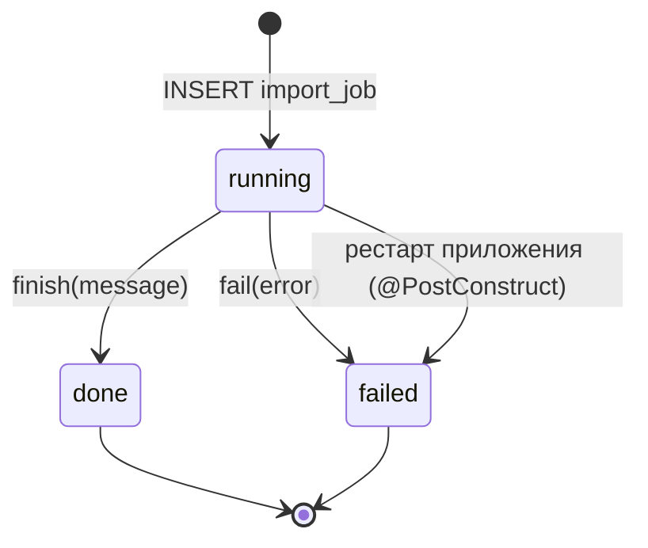
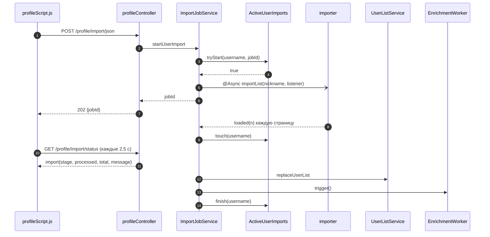

# Код AnimeQuiz: справочник по классам и потокам

Документ описывает код на уровне «кто за что отвечает и на что опираться при
правке», актуален для `0.1.32-SNAPSHOT`. Стек, инфраструктура, схема данных и
выкат разобраны в `docs/architecture.md`; здесь — прикладной слой.

Содержание:

1. [Дерево исходников](#1-дерево-исходников)
2. [Карта пакетов](#2-карта-пакетов)
3. [Точка входа и конфигурация](#3-точка-входа-и-конфигурация)
4. [HTTP и STOMP API](#4-http-и-stomp-api)
5. [Контроллеры](#5-контроллеры)
6. [Сервисы: пользователи и сессии](#6-сервисы-пользователи-и-сессии)
7. [Сервисы: каталог и список пользователя](#7-сервисы-каталог-и-список-пользователя)
8. [Сервисы: импорт и задачи](#8-сервисы-импорт-и-задачи)
9. [Сервисы: обогащение, постеры, хранилище](#9-сервисы-обогащение-постеры-хранилище)
10. [Импортёры внешних источников](#10-импортёры-внешних-источников)
11. [Модель данных и репозитории](#11-модель-данных-и-репозитории)
12. [Ошибки, валидация, безопасность](#12-ошибки-валидация-безопасность)
13. [Фронтенд](#13-фронтенд)
14. [Фоновые задачи](#14-фоновые-задачи)
15. [Тесты](#15-тесты)
16. [Инварианты и подводные камни](#16-инварианты-и-подводные-камни)
17. [Известные ограничения и долги](#17-известные-ограничения-и-долги)

## 1. Дерево исходников

```
src/main/java/com/example/animequiz/
├── AnimeQuizApplication.java     точка входа Spring Boot
├── controller/                   MVC-страницы, REST, WebSocket
├── dto/                          тела запросов от админки
├── entity/                       JPA-сущности и транспортные POJO
├── exceptions/                   доменные исключения + @RestControllerAdvice
├── Interfaces/                   CustomUserDetails
├── repository/                   Spring Data JPA
├── securityConfig/               Security, Async, провайдеры, обработчик ошибок входа
├── service/                      бизнес-логика
│   ├── catalog/                  upsert и слияние тайтлов
│   ├── enrichment/               фоновое дообогащение каталога
│   ├── importer/                 Shikimori, MAL, Yummy + общий контракт
│   └── ratelimit/                лимиты запросов к внешним API
├── validation/                   проверка пользовательского ввода
└── websocketConfig/              STOMP-эндпоинт и проверка Origin
```

## 2. Карта пакетов

| Пакет | Что внутри | Правило |
|---|---|---|
| `controller` | тонкий слой: разбор запроса, вызов сервиса, модель или JSON | без прямой работы с репозиториями и `EntityManager` |
| `service` | вся логика, транзакции, интеграции | контроллеры вызывают только сервисы |
| `service.importer` | вызовы внешних API и маппинг в `AnimePatch` / `RatingEntry` | только здесь ходят в Shikimori, MAL, Yummy |
| `service.enrichment` | планировщик дообогащения и скачивания постеров | единственный, кто ставит `poster_status` |
| `repository` | Spring Data JPA, немного нативных запросов | имя метода = запрос, сложные случаи — `@Query` |
| `entity` | JPA-сущности + `UserDto` и `greetingsDTO` для ответов | сущности не сериализуются в API напрямую, кроме админских ручек |
| `securityConfig` | фильтр-цепочка, пул `@Async`, сессии | сюда же `SessionRegistry` |
| `validation` | `InputValidation` — единственное место с правилами длины и символов | не дублировать регулярки в контроллерах |

## 3. Точка входа и конфигурация

### `AnimeQuizApplication`
`@SpringBootApplication`, `@EnableScheduling`, `@EnableAsync`. Всё остальное
поднимается автоконфигурацией.

### `application.properties` — что важно

| Ключ | Значение | Зачем |
|---|---|---|
| `server.port` | `8081` | порт приложения и контейнера |
| `server.servlet.session.timeout` | `30m` | используется и `SessionService` для чистки реестра |
| `server.shutdown` | `graceful` | 20 с на завершение запросов |
| `app.version` | `@project.version@` | подставляется Maven-фильтром, показывается в футере |
| `spring.jpa.open-in-view` | `true` | ленивые связи `Authority → User` живут до рендера ответа |
| `spring.datasource.url` | `localhost:5433`, схема `main` | локальный Postgres; в Docker переопределяется на `db:5432` |
| `spring.flyway.default-schema` | `main` | все таблицы и история миграций в `main` |
| `app.storage.location` | `~/.animequiz/storage` | локально; в Docker `/app/storage` |
| `app.yummy.*`, `app.mal.*`, `app.shikimori.*` | базовые URL, токен, User-Agent | внешние API |
| `spring.jpa.hibernate.ddl-auto` | `validate` | схему меняет только Flyway |

### `securityConfig.SecurityConfig`
- CSRF включён, токен читается через `XorCsrfTokenRequestAttributeHandler` и
  называется `_csrf`; фронт берёт его из `<meta name="_csrf">`.
- Сессия `ALWAYS`, `maximumSessions(-1)` — ограничения на число сессий нет,
  но все сессии попадают в `SessionRegistry`, чтобы админ мог их гасить.
- Правила доступа: `/login`, `/register`, `/auth/**` — всем; `/admin/**` —
  только `ROLE_ADMIN`; `/profile/import` — аутентифицированным; всё
  остальное — `permitAll()`.
- `HttpFirewall` ослаблен для заголовков: разрешены любые назначенные
  Юникод-символы, кроме управляющих, иначе `StrictHttpFirewall` отбивает
  запросы с не-ASCII в заголовках до Spring Security.
- Пароли — `BCryptPasswordEncoder(12)`.

### `securityConfig.AsyncConfig`
Пул `taskExecutor`: ядро 4, максимум 12, очередь 200, префикс `async-`,
обёрнут в `DelegatingSecurityContextAsyncTaskExecutor`, чтобы в `@Async` был
доступен `SecurityContext`. Этим пулом пользуются задачи импорта.

### `securityConfig.AuthenticationFailureHandler`
Переводит исключение входа в код в URL: `BadCredentials → ?error=credentials`,
`Disabled → ?error=disabled`, `Locked → ?error=locked`, остальное `?error`.
`AuthController` превращает код в текст на странице входа.

### `websocketConfig`
- Брокер простой (в памяти), префикс назначения `/gameResponse`, очереди `/game`.
- Эндпоинт `"/AniQuiz"` без SockJS, с `SameOriginHandshakeInterceptor`.
- Входящий канал отбрасывает любой `SEND` вне `/gameResponse/**`, поэтому
  клиент не может публиковать напрямую в `/game/**`.
- Аутентификации на STOMP нет: `lobby` — гостевая демка.

### `websocketConfig.SameOriginHandshakeInterceptor`
Сравнивает `Origin` с хостом запроса; пустой `Origin` пропускается (так ведут
себя не-браузерные клиенты), несовпадение — 403.

## 4. HTTP и STOMP API

### Страницы (MVC)

| Метод | Путь | Доступ | Шаблон |
|---|---|---|---|
| GET | `/` | все | `home` |
| GET | `/login` | все | `login` |
| GET | `/register` | все | `register` |
| GET | `/profile` | все (гость тоже) | `profile` |
| GET | `/admin` | `ROLE_ADMIN` | `admin` |
| GET | `/lobby` | все | `lobby` |
| GET | `/test` | все | `image-choice` (демо `/choose`) |

### REST

| Метод | Путь | Доступ | Тело / параметры | Ответ |
|---|---|---|---|---|
| POST | `/auth/register` | все | `{username, password}` | `{message}` |
| POST | `/setCustomName` | все | `userName` | `{message}` или 400 |
| POST | `/profile/name` | все | `userName` | редирект на `/profile` |
| POST | `/profile/avatar` | все | multipart `avatar` | редирект на `/profile`; flash `error` при плохом файле или сбое записи |
| POST | `/profile/avatar/json` | все | multipart `avatar` | `{message}`; 400 при плохом файле, 500 при сбое записи |
| GET | `/profile/avatar?user=` | все; чужой аватар — только админ | — | файл или 404 |
| POST | `/profile/import/json` | проверка в методе | `nickname`, `source` | `202 {message, jobId, source, nickname}`, `409` при занятом импорте |
| GET | `/profile/import/status` | проверка в методе | — | см. ниже |
| GET | `/profile/titles` | проверка в методе | `page`, `size`, `q`, `status`, `onlyLocal`, `sort` | страница списка |
| GET | `/getUsers` | `ROLE_ADMIN` | — | `UserDto[]` |
| GET | `/getAdminInfo` | `ROLE_ADMIN` | — | профиль текущего админа |
| POST | `/createUser` | `ROLE_ADMIN` | `UserRequest` | `{message}` |
| POST | `/editUser` | админ или сам себя | `UserRequest` | `{message, isSelfUpdate}` |
| DELETE | `/deleteUser` | админ (не себя) или сам себя | `UserRequest` | `{message}` |
| POST | `/ImportSiteAnimeList` | `ROLE_ADMIN` | — | `{message, jobId}` или `{message, running}` |
| GET | `/ImportSiteAnimeList/status` | `ROLE_ADMIN` | — | `{state, stage, processed, total, message, error, running}` |
| GET | `/getUploadDate` | `ROLE_ADMIN` | — | `{message}` — дата последнего `site_import` в `yyyy-dd-MM` (UTC) |
| GET | `/media/posters/{hash}.{ext}` | все | — | файл, `Cache-Control: immutable` на год |

`/profile/import/json` и `/profile/import/status` сами проверяют
`AuthService.isAuthenticated`, потому что матчер в `SecurityConfig` задан как
`/profile/import` и подпути не покрывает.

### STOMP

| Направление | Назначение | Обработчик |
|---|---|---|
| SEND | `/gameResponse/hello` | `GreetingController.greeting` |
| MESSAGE | `/game/greetings` | ответ через `@SendTo` |

## 5. Контроллеры

| Класс | Ответственность | Неочевидное |
|---|---|---|
| `homeController` | главная | имя гостя берёт из cookie `CustomUserName`, у залогиненного — `displayName` из `CustomUserDetails` |
| `AuthController` | тексты ошибок входа | `credentials/session/disabled` → отдельные сообщения, остальные коды (в том числе `locked`) → общая фраза |
| `RegisterController` | `POST /auth/register` | роль всегда `USER`, имя = никнейм |
| `profileController` | профиль, список, импорт, аватар | два пути для имени и аватара: HTML-форма и JSON; гостю выдаётся cookie-идентификатор `g_<uuid>` |
| `adminController` | админка и импорт каталога сайта | при занятом импорте отдаёт 200 с `running=true`, а не 409 |
| `UserController` | CRUD пользователей | `editUser` сам себя может менять и обновляет `SecurityContext` в сессии |
| `MediaController` | отдача постеров | отдаёт только существующий файл, кэш неизменяемый |
| `GlobalModelAttributes` | `appVersion` во всех шаблонах | футер проверяет деплой именно по нему |
| `websocket.GreetingController` | демо STOMP | имя чистится `normalizeLobbyName`, при ошибке `guest` |

### Что делает `profileController.profile()`
Добавляет `displayName`, `authenticated`, `hasAvatar`, `userRole`. Гость
получает аватар по cookie `GUEST_COOKIE` (год жизни), залогиненный — по
ключу `u_<username>`. Роль вычисляется по `authorities`, а не по токену.

### Как устроен `storageKey`
`u_<username>` для залогиненного, `g_<uuid>` для гостя; uuid создаётся при
первом обращении и кладётся в cookie на год. Один и тот же ключ используют
загрузка и выдача аватара, поэтому имена файлов совпадают.

## 6. Сервисы: пользователи и сессии

### `UserService`
- `createUser` валидирует никнейм и имя через `InputValidation`, пароль — не
  короче 6 символов; роль приводит к `ROLE_USER` / `ROLE_ADMIN`
  (`ALLOWED_ROLES`), всё остальное падает на `resolveRole`.
- Дубликат никнейма ловится как `DataIntegrityViolationException` и
  превращается в `ConflictException` (409).
- `deleteUser` удаляет пользователя, гасит его сессии и стирает аватар;
  ошибка удаления файла только логируется.
- `updateUserByAdmin` меняет имя, флаг `enabled`, и при смене роли заменяет
  единственную запись в `authorities`; после этого сессии пользователя
  принудительно истекают.
- `updateSelfProfile` меняет только `displayName`.

### `SessionService`
- `expireUserSessions` проходит по `SessionRegistry` и помечает сессии
  пользователя истёкшими — так бан и смена роли применяются сразу.
- `purgeIdleSessions` раз в 10 минут выкидывает из реестра сессии, которые не
  обновлялись дольше `server.servlet.session.timeout`.

### `AuthService`
Статические `isAuthenticated` / `isAdmin` (одинаково понимают
`AnonymousAuthenticationToken`) и пересборка `Authentication` после смены
профиля: `refreshAuthentication` + `updateSecurityContext` кладут новый
principal в текущую сессию, поэтому новое имя видно без перелогина.

### `CustomUserDetailsService`
Читает `User` и `Authority` по никнейму, собирает `CustomUserDetailsImpl`
(никнейм, хеш пароля, `displayName`, права, `enabled`). `enabled=false`
приводит к `DisabledException` — отсюда `?error=disabled`.

## 7. Сервисы: каталог и список пользователя

### `catalog.AnimeCatalogService`
Отвечает за дедупликацию тайтлов по трём внешним идентификаторам.

- `upsert(AnimePatch)` ищет записи по `shikimoriId`, `malId`, `yummyId`.
  Ноль совпадений — новая запись; одно — обновление; несколько — слияние в
  самую старую (минимальный `id`), остальные удаляются через `merge`.
- `applyPatch` заполняет только пустые поля, кроме `title` (перезаписывается
  всегда) и `posterUrl` (перезаписывается непустым); `completeness` только
  растёт по рангу `stub < partial < full`.
- `merge(keep, drop)` переносит `user_anime` (`transferUserAnime`), удаляет
  `drop` с `flush()`, затем добирает недостающие поля и постер.
- `AnimePatch` — builder-запись; её же возвращают импортёры и enrichment.

### `UserListService`
Две проекции одного и того же чтения:

- `getUserListPage(username, page, size, query, statuses, onlyLocal, sort)` —
  для страницы профиля: фильтры, сортировка, срез, счётчики.
- `getUserListView(username)` — для статуса импорта: готовые к показу тайтлы,
  `hiddenCount`, `totalCount`.

Правила, которые легко забыть:

- `loadViews` берёт `user_anime` пользователя, подтягивает `anime` одним
  `findAllById` и прячет тайтл (`hidden`), если он не «полностью обработан»:
  `completeness = stub` или постер ещё `pending`.
- `ready` — это и есть «видимый» список; `withPoster` считает записи с
  `posterHash` и `posterExt`.
- `onlyLocal=true` отбрасывает тайтлы без постера; `statusCounts` считаются
  по видимым, а не по всем записям.
- Сортировки: `title-asc/title-desc` (Collator `ru`, записи с буквы впереди),
  `score-desc/score-asc` (пустой балл = 0), `status` (порядок
  `watching → rewatching → planned → completed → on_hold → dropped`).
- `size` зажимается в `1..200`, `page` — не меньше нуля; `hasMore`
  вычисляется по срезу, а не по счётчику.
- `replaceUserList` — полная замена списка: удаляет все `user_anime`
  пользователя, батчем ищет каталог по Shikimori- и MAL-id, для неизвестных
  создаёт заглушку (`title = "Unknown #<id>"`, `completeness = stub`) и только
  после этого пишет `user_import` с источником, никнеймом и датой.

## 8. Сервисы: импорт и задачи

### `ImportJobService`
Единая точка запуска обеих разновидностей импорта. `ImportJob.type`:
`site_import` (каталог сайта, админка) и `user_import` (список пользователя).

Жизненный цикл задачи:



Методы:

| Метод | Что делает |
|---|---|
| `init()` | при старте помечает все `state='running'` как `failed` с причиной «Прервано перезапуском приложения» |
| `currentRunning(type)` / `lastJob(type)` | выборка активной и последней задачи |
| `startUserImport(username, importer, nickname)` | создаёт задачу, атомарно захватывает пользователя, отдаёт `jobId` |
| `runUserImportAsync(jobId, …)` | `@Async`: загрузка → сохранение → `done`, любое исключение → `failed` |
| `jobById(id)` | чтение задачи для статуса |
| `startSiteImport()` / `runSiteImportAsync()` | импорт каталога Shikimori + пакетное обогащение Yummy |
| `update` / `saveCheckpoint` / `finish` / `fail` | запись прогресса, чекпоинта (`jsonb`) и финального состояния |

Особенности:

- Синхронный `startUserImport` пишет `jobId` в `ActiveUserImports` через
  `tryStart`; при отказе только что созданная задача удаляется, а вызывающий
  получает `IllegalStateException` (контроллер переводит в 409).
- `@Async` вызывается через `self.getObject()`, иначе прокси не сработает и
  импорт пойдёт в потоке HTTP-запроса.
- `runUserImportAsync` в `finally` всегда освобождает пользователя, поэтому
  зависший импорт не блокирует следующие попытки дольше 10 минут.
- Прогресс пользовательского импорта: стадия `enumeration` с растущим
  `processed` и неизвестным `total`, затем `saving` с `processed = 0` и
  `total = количество записей`; итоговое сообщение —
  `Импортировано: N (source: nickname)`.
- Стадии `site_import`: `enumeration` (каталог), `yummy` (обогащение пачками по
  100), `posters` (запуск фонового скачивания). Ошибка одной пачки Yummy не
  роняет задачу — только пишется в лог.
- `error` содержит простое имя класса исключения, стектрейс остаётся в логе.

Пользовательский импорт целиком:



### `ActiveUserImports`
Память о том, кто сейчас импортирует. Хранит `UserData(time, jobId, running)`
в `ConcurrentHashMap`.

| Метод | Смысл |
|---|---|
| `tryStart(username, jobId)` | атомарный захват: `compute` проверяет занятость и пишет запись одной операцией |
| `touch(username)` | продлевает время жизни записи при прогрессе |
| `finish(username)` | ставит `running=false`, но запись с `jobId` оставляет |
| `isRunning` / `runningJobId` | активный импорт и его задача |
| `lastJobId` | последняя задача, включая завершённую — нужна для позднего поллинга |
| `purgeStale` | раз в 5 минут удаляет записи старше 10 минут |

Запись после `finish` живёт до устаревания (10 минут): клиент успевает
дочитать финальный статус, а новый импорт можно запускать сразу. Если процесс
упал, запись всё равно протухнет и пользователь не останется заблокированным.

## 9. Сервисы: обогащение, постеры, хранилище

### `enrichment.EnrichmentWorker`
Раз в 15 секунд берёт до 40 тайтлов из `findEnrichQueue` и обогащает каждый в
отдельной транзакции (`REQUIRES_NEW`), чтобы одна ошибка не откатывала пачку.

- Пропускает работу, пока идёт `site_import`.
- Флаг `triggerRequested` позволяет разбудить цикл сразу после импорта;
  одновременно работает не больше одного прохода.
- Источники по порядку: Shikimori (если есть id и ещё не было), Yummy
  (по `yummyId`, иначе по `shikimoriId` / `malId`), MAL (только если нет
  `posterUrl`). Что удалось получить — сливается `mergePatches` в один патч,
  который уходит в `catalog.upsert`.
- После сохранения скачивает постер, если есть `posterUrl` и нет `posterHash`:
  успех → `poster_status=ready` и заполненные `poster_*`; ошибка → `failed`;
  нет URL → `no_image`.
- Учёт: `enrichAttempts += 1`, `enrichedAt = now`, `enrichNextAt = null`,
  `enriched_sources` пополняется. `stub` при удачном патче становится
  `partial`.
- Ошибка не роняет цикл: `enrichLastError` и отложенный `enrichNextAt` с
  бэкоффом 5 мин → 30 мин → 2 ч → 12 ч → 24 ч.

### `PosterStorageService`
Хранит постеры в `<storage>/posters/<aa>/<bb>/<sha256>.<ext>` и держит индекс
«URL → хеш».

- Индекс — журнал `_url_index.log` со строками `<hash> <url>`; старый
  `_url_index.json` читается один раз и переписывается в новый формат.
- В памяти Guava-кэш `urlToHash` (до 100 000 записей) и счётчик строк на диске;
  при превышении порога (`max(1000, 2 × размер кэша)`) журнал сжимается.
- `downloadAndStore` проверяет схему (только http/https), нормализует
  `//host` в `https://`, отбрасывает заглушки `missing_preview`, качает с
  таймаутом 30 с, лимитом 10 МБ и белым списком MIME (png, jpeg, gif, webp);
  запись атомарная через временный файл.
- `findByUrl` ищет в кэше и проверяет файл на диске; битая запись
  инвалидируется.
- `resolve(hash, ext)` — то, что использует `MediaController`.
- Скачивание проходит через `SourceRateLimiter` с ключом `poster` (10 запросов
  в секунду).

### `StorageService`
Аватары в `<storage>/avatars/`:

- `sanitizeKey` оставляет только `[A-Za-z0-9_-]`, поэтому имя файла не может
  выйти за пределы каталога.
- `saveAvatar` проверяет размер (5 МБ) и формат по сигнатуре файла
  (png/jpeg/gif/webp), удаляет старый файл и пишет новый под блокировкой из
  `Striped.lock(64)` — одна полоса на ключ, чтобы параллельные загрузки не
  оставили два файла. Заявленный клиентом `Content-Type` не используется, а
  расширение берётся из определённого типа: GIF, переименованный в `.png`,
  сохранится как `.gif`.
- Ошибки ввода-вывода не заворачиваются: чтение multipart и запись файла
  пробрасываются как `IOException`. Контроллер логирует их, пишет в лог
  исходную причину, а пользователю отдаёт общее сообщение (flash в HTML-форме,
  500 в JSON-ручке).
- `findAvatar` ищет файл по префиксу `<key>.`, `deleteAvatar` удаляет все
  совпадения.

### `MimeTypes`
Утилита без состояния, общая для постеров и аватаров:

- `detectMime(bytes)` — сигнатуры PNG, JPEG, GIF, WebP; всё остальное —
  `application/octet-stream`.
- `isAllowedMime`, `extFor`, `mimeForExt` — белый список и обратное
  сопоставление MIME ↔ расширение (белый список: png, jpeg, gif, webp).
- `sha256Hex` — хеш для имени файла постера, `isSha256` — проверка строки
  индекса `_url_index.log`.

## 10. Импортёры внешних источников

### Контракт `AnimeListImporter`

```java
String sourceName();
ImportResult importList(String nickname);
default ImportResult importList(String nickname, ProgressListener onProgress) { … }
AnimePatch fetchFull(long sourceId);
interface ProgressListener { void loaded(int loaded); }
```

`ImportResult` — `userId`, `nickname`, `count`, список `RatingEntry`
(`sourceAnimeId`, три внешних id, `sourceRateId`, `status`, `score`,
`episodesWatched`, `rewatches`). `ProgressListener` сообщает, сколько записей
источник уже отдал, — из этого складывается прогресс задачи.

| Источник | Как читает список | Особенности |
|---|---|---|
| `ShikimoriService` | `/users/{nick}?is_nickname=1`, затем `/users/{id}/anime_rates` по 50 на страницу | до 500 страниц, 4 попытки с паузой 3.2 с, отдельная обработка 429; `fetchSiteCatalog` тянет `/animes` для импорта каталога |
| `MalService` | веб-страница `myanimelist.net/animelist/{nick}/load.json` по 300 записей | не нужен client-id; 403/404 означают «нет списка»; `fetchFull` уже через официальный API и требует `app.mal.client-id` |
| `YummyAnimeService` | `/users/{id}/lists` | id пользователя ищется по никнейму и кэшируется на 12 ч (до 1000 записей); без `app.yummy.app-token` сервис пишет предупреждение и не работает; умеет искать тайтлы по Shikimori/MAL id |

Все три ходят через `SourceRateLimiter` и возвращают `AnimePatch`, поэтому
дедупликацию делает только `AnimeCatalogService`.

### `ratelimit.SourceRateLimiter`
`ConcurrentHashMap<String, RateLimiter>` Guava, лимиты запросов в секунду:
`shikimori 1.2`, `mal 2.5`, `yummy 1.5`, `poster 10.0`, по умолчанию `1.0`.
Ключ — произвольная строка, новый источник достаточно добавить в `limits`.

## 11. Модель данных и репозитории

Миграции: `V1__init` (users, authorities), `V2__add_test_admin` (демо-аккаунты
`admin`/`user`), `V3__add_display_name`, `V4__anime_catalog` (anime,
user_anime, user_import, import_job, индексы, `pg_trgm`).

### Сущности

| Сущность / таблица | Ключевое | Поведение |
|---|---|---|
| `User` / `users` | PK `username` | `authorities` — `@OneToMany` c `cascade = ALL`, `orphanRemoval` и `EAGER`; `enabled` выключает вход |
| `Authority` / `authorities` | FK `username` | реализует `GrantedAuthority`, пара `(username, authority)` уникальна |
| `Anime` / `anime` | PK `id` | три уникальных внешних id; `posterStatus` (`pending/ready/failed/no_image`), `completeness` (`stub/partial/full`), очередь обогащения (`enrichNextAt`, `enrichAttempts`, `enrichedSources`) |
| `UserAnime` / `user_anime` | уникальная пара `(user_id, anime_id)` | оценка, прогресс, статус, источник |
| `UserImport` / `user_import` | PK `user_id` | последний импорт: источник, никнейм, количество, дата |
| `ImportJob` / `import_job` | PK `id` | состояние, стадия, счётчики, `checkpoint` (`jsonb`), времена |

### Репозитории

| Репозиторий | Методы, важные для поведения |
|---|---|
| `AnimeRepository` | поиск по каждому внешнему id; `findAllBy…IdIn` для батчей; нативный `findEnrichQueue` — приоритет `stub`, затем популярные, затем давно не пробованные |
| `UserAnimeRepository` | `findByUserId`; `deleteAllByUserId`; `transferUserAnime` = удалить конфликтующие пары + перенести остальные (нужно при слиянии тайтлов) |
| `ImportJobRepository` | `findFirstByTypeAndStateOrderByIdDesc`, `findTop10ByTypeOrderByIdDesc`, `failAllRunningJobs` для старта |
| `UserImportRepository` | обычный CRUD по `user_id` |
| `UserRepository` | `findByUsername` |
| `AuthoritiesRepository` | `findByUserUsernameWithUser` с `join fetch`, чтобы не ловить `LazyInitializationException` |

## 12. Ошибки, валидация, безопасность

### Исключения

| Класс | Код ответа | Когда |
|---|---|---|
| `InvalidInputException` | 400 | пустой или недопустимый ввод |
| `ConflictException` | 409 | занятый никнейм |
| `NotFoundException` | 404 | нет пользователя, тайтла, источника не знает id |
| `ExternalServiceException` | 502 | внешний API ответил ошибкой |
| `AccessDeniedException` (Spring) | 403 | недостаточно прав |
| `MaxUploadSizeExceededException` | 413 | файл больше `max-file-size` |
| всё остальное | 500 | логируется целиком, клиенту — общая фраза |

`GlobalExceptionHandler` — `@RestControllerAdvice`, поэтому ошибки MVC-страниц
тоже превращаются в JSON.

### `InputValidation`

| Метод | Правило |
|---|---|
| `normalizeUsername` | trim, 2–64 символа, `\p{L}\p{N}_.-` |
| `normalizeDisplayName` | trim, не пусто, ≤ 64 code points, без `<>` и управляющих |
| `normalizeLobbyName` | то же, отдельный лимит 64 |
| `forLog` | вырезает управляющие символы и обрезает до 128 — для логов |

### Безопасность по слоям

- URL — Spring Security, роли `ROLE_ADMIN` / `ROLE_USER`, CSRF на всех
  POST/DELETE.
- Методы — `@PreAuthorize` в `UserController` и `adminController`.
- Импорт и профиль — явные проверки `AuthService` внутри контроллера.
- Файлы — `sanitizeKey`, проверка формата по сигнатуре и размера, лимит multipart 5 МБ.
- Логи — пользовательские строки только через `InputValidation.forLog`.

## 13. Фронтенд

Шаблоны Thymeleaf и статика без сборщика: jQuery, свои CSS и JS, STOMP только
в лобби.

| Файл | Назначение |
|---|---|
| `templates/home.html` + `homePage/homeScript.js` | лендинг, демо-карточки |
| `templates/login.html`, `register.html` + `auth/*` | вход, регистрация, тосты об ошибках |
| `templates/profile.html` + `profilePage/profileScript.js` | профиль: имя, аватар, импорт, список тайтлов |
| `templates/admin.html` + `adminPage/adminScript.js` | пользователи и импорт каталога |
| `templates/lobby.html` + `lobby/app.js` | STOMP-демка |
| `templates/image-choice.html` | демо `/test` и `/choose` |
| `templates/fragments/header.html`, `footer.html` | общие шапка и подвал, версия из `appVersion` |
| `static/header.js` | модалки имени и аватара, загрузка через `/profile/avatar/json` |
| `static/modal.js` | стек модалок, блокировка скролла, промисы для `confirm` |
| `static/toast.js` | `showToast(message, type)` |
| `static/pageVisibility.js` | останавливает анимации, когда вкладка скрыта |

### Контракт `profileScript.js`
- `loadPage(reset)` собирает параметры: `page`, `size=60`, `q`, `status`,
  `onlyLocal`, `sort`; ответ рендерится в карточки, есть предзагрузка
  следующей страницы и кэш по ключу страницы.
- Поиск с задержкой 180 мс, фильтры по статусам — кнопки-счётчики,
  переключатель «только с постерами», вид «сетка/список», «загрузить ещё».
- `startPosterPolling(announceImport)` опрашивает `/profile/import/status`
  каждые 2.5 с: сначала показывает прогресс импорта (процент, если известен
  `total`, иначе бегущую полосу), после завершения — тост с итогом или
  ошибкой, перезагрузку списка и прогресс постеров `ready / total`.
- Статус постеров считается завершённым, когда `running=false` и
  `hidden=0`; после 240 попыток поллинг прекращается с сообщением, что
  прогрев идёт в фоне.

### JSON-ответы, на которые опирается фронт

`GET /profile/titles`:

```
titles[], count, page, size, hiddenCount, totalCount, readyCount,
withPosterCount, filteredCount, hasMore, statusCounts{}, source, importedAt
```

`GET /profile/import/status`:

```
running, import{jobId, state, stage, processed, total, message, error,
startedAt, finishedAt}, total, ready, hidden, done
```

`total` здесь — все записи `user_anime`, `ready` — видимые, `done` — импорт не
идёт и скрытых нет. Объект `import` появляется только если у пользователя
есть задача (в том числе уже завершённая, пока запись в `ActiveUserImports`
не устарела).

## 14. Фоновые задачи

| Задача | Период | Где |
|---|---|---|
| Обогащение каталога | `PT15S` | `EnrichmentWorker.tick` |
| Чистка устаревших записей импорта | `PT5M` | `ActiveUserImports.purgeStale` |
| Чистка реестра сессий | `PT10M` | `SessionService.purgeIdleSessions` |
| Пометка прерванных импортов | один раз при старте | `ImportJobService.init` |
| Импорт каталога и импорт пользователя | по запросу | `@Async` в пуле `taskExecutor` |

Планировщик один на процесс: `@EnableScheduling` включает
`ThreadPoolTaskScheduler` по умолчанию с одним потоком, поэтому длинные задачи
в `@Scheduled` блокируют остальные тики.

## 15. Тесты

`src/test/java` — 26 тестовых классов плюс вспомогательный `LocalHttpServer`:
контроллеры через `MockMvc` (standalone или
`@SpringBootTest`), сервисы через Mockito, импортёры — против локального
HTTP-сервера (`LocalHttpServer` вместо WireMock), отдельно
`InputValidationTest` и `SameOriginHandshakeInterceptorTest`.

- `ProfileControllerTest` фиксирует контракт импорта: 202 + `jobId`, 409 при
  повторном запуске, вложенный `import` в статусе, 401 без входа.
- `ImportJobServiceTest` проверяет откат при `RejectedExecutionException`,
  прогресс `enumeration → saving`, итоговое сообщение и `init()`.
- `ActiveUserImportsTest` — захват, устаревание, сохранение `jobId` после
  `finish`, повторный запуск.
- `UserListServiceTest` — скрытие тайтлов, фильтры, сортировки, счётчики.

Запуск: `mvn verify` на JDK 17 (enforcer не даст собрать на другом JDK).
Spotless входит в `verify`, поэтому форматирование проверяется там же.

## 16. Инварианты и подводные камни

- **`@Async` и `@Transactional` только через прокси.** Внутри класса вызывать
  их через `this` нельзя: `ImportJobService` использует
  `self.getObject()`, `EnrichmentWorker` — так же для `enrichOne`.
- **Один активный импорт на пользователя.** Захват — только `tryStart`;
  любые новые пути запуска обязаны проходить через него, иначе появятся две
  задачи на одного человека.
- **`finish` не удаляет запись.** Если сделать `remove`, клиент потеряет
  финальный статус и покажет «постеры загружены» без итога импорта.
- **Порядок записи задачи.** `ImportJob` сохраняется до `tryStart`: нужен
  `id`, который попадёт в карту. При отказе задача удаляется, чтобы в таблице
  не копились брошенные `running`.
- **Прогресс — это `UPDATE`, а не память.** Всё, что видит пользователь,
  лежит в `import_job`; после рестарта задача станет `failed`, но история
  останется.
- **Список пользователя заменяется целиком.** `replaceUserList` сначала
  удаляет `user_anime`, поэтому частичный сбой импортёра означает потерю
  списка — новые источники должны сначала загрузить данные, потом писать.
- **Скрытые тайтлы — не ошибка.** `hidden > 0` означает «ещё нет постера или
  каталог не обогащён»; именно это крутит поллинг после импорта.
- **Матчер `/profile/import` не покрывает подпути.** Доступ к `.../json` и
  `.../status` держится на проверках внутри методов; при добавлении нового
  эндпоинта проверку нужно повторить или расширить матчер до
  `/profile/import/**`.
- **`media/posters` кэшируется на год.** Перезапись файла с тем же хешем
  невозможна по построению (хеш = содержимое), поэтому агрессивный кэш
  безопасен; не меняйте это, не придумав версионирование URL.
- **Гостевые данные живут в cookie.** Имя (`CustomUserName`, 7 дней) и
  аватар (`g_<uuid>`, год); при очистке cookie гость теряет и то, и другое.
- **Ключ аватара — `u_<username>`.** Переименование пользователя в системе не
  предусмотрено; при его появлении нужно переносить файл.

## 17. Известные ограничения и долги

- Нет аутентификации на WebSocket: лобби открыто всем, кто знает адрес.
- Сессии и состояние импортов — в памяти процесса, поэтому горизонтальное
  масштабирование невозможно без внешнего хранилища.
- Нет actuator и healthcheck у `app`: деплой проверяет версию в футере.
- `YummyAnimeService` требует токен и без него молча выключен (только warn в
  лог при старте).
- `MalService` читает список с веб-страницы MAL, а не через API; смена
  разметки или защита от парсинга сломает импорт, API используется только для
  `fetchFull`.
- `getUserListPage` грузит весь список пользователя в память и сортирует в
  приложении — для очень больших списков это узкое место.
- `UserRequest` содержит `avatarUrl`, но создание и редактирование его не
  используют: аватар меняется только через отдельные ручки.
- `AnimeQuizService` — демо-заглушка с внешними картинками (`picsum.photos`),
  к реальному каталогу не подключена.
